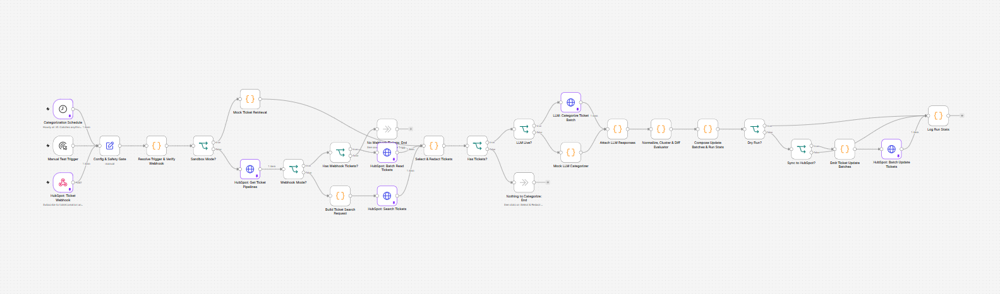

<div align="center">

# n8n-hubspot-support-ticket-topic-cluster-categorizer

**Natural language processing pipeline that analyzes open HubSpot support ticket subjects and descriptions, automatically clustering recurring bug or feature request themes for product feedback sync.**

A dhRobin Systems Revenue Infrastructure blueprint

     

</div>

---

## Table of Contents

1. [Overview](#1-overview)
2. [Architecture](#2-architecture)
3. [Repository Contents](#3-repository-contents)
4. [Prerequisites](#4-prerequisites)
5. [5-Minute Sandbox Quick Start](#5-5-minute-sandbox-quick-start)
6. [Environment Variables](#6-environment-variables)
7. [Node-by-Node Configuration Guide](#7-node-by-node-configuration-guide)
8. [Categorization Schema and Cluster Model](#8-categorization-schema-and-cluster-model)
9. [Safety Matrix](#9-safety-matrix)
10. [Data Protection and Compliance](#10-data-protection-and-compliance)
11. [Deployment and Promotion Path](#11-deployment-and-promotion-path)
12. [Operations and Troubleshooting](#12-operations-and-troubleshooting)
13. [Disclaimer and License](#13-disclaimer-and-license)

---

## 1. Overview

Product teams ask the same question every sprint: *what are customers actually reporting?* The answer is in the support queue, buried in free text that no one has time to read. I built this pipeline to read it continuously: every open ticket gets a category, a theme cluster, sentiment and an impact-based priority. Recurring clusters surface as a product-feedback digest, and HubSpot reports can group tickets by theme.

**The pipeline runs in two modes:**

| Mode | Trigger | Selection |
|---|---|---|
| **Scan** | Schedule (hourly) or Manual Test Trigger | Open tickets that were never categorized, were created within `NEW_TICKET_LOOKBACK_HOURS`, or were categorized under an older `TAXONOMY_VERSION` |
| **Event** | HubSpot webhook (`ticket.creation`, `ticket.propertyChange` on subject or content) | The changed tickets, read with batch read |

**Per run, the pipeline:**

1. Selects eligible tickets: open stage, not human-locked, enough text, and content or taxonomy changed since the last categorization (content hash).
2. **Redacts** emails, phone numbers, card numbers (Luhn-checked), IP addresses, URL query strings, long numeric IDs and your own terms, then truncates the text.
3. Sends tickets in chunks of `BATCH_SIZE` to an OpenAI-compatible LLM with a **strict JSON Schema**, one request every `RATE_LIMIT_DELAY_MS`.
4. Validates every result, **merges near-duplicate cluster keys**, applies `KNOWN_CLUSTERS`, and diffs against existing HubSpot values without ever overwriting valid data with empty values.
5. Writes changes in HubSpot batch updates (≤ 100 tickets per call), and logs run statistics plus a product-feedback digest of recurring clusters.

**Design principles**

| Principle | Implementation |
|---|---|
| Safe by default | With no environment variables set, the pipeline makes **zero external API calls and zero CRM writes**. |
| Redact before the model | Personal data is replaced with tokens such as `[EMAIL]` and `[CARD]` inside n8n, before any LLM request. |
| Pay once per text | A ticket is only re-sent when its subject or content changes, or when `TAXONOMY_VERSION` is bumped. |
| People override the model | `ticket_topic_locked = true` freezes a ticket's categorization, and `needs_review` tickets wait for a person. |
| Never overwrite with less | Blank or invalid model output never replaces an existing value (`fieldsProtected`). |
| Integrity guards | A response-count mismatch fails the run. Results referencing tickets that weren't in the request open the circuit breaker. |
| Secrets out of data | `HUBSPOT_PRIVATE_APP_TOKEN` and `LLM_API_KEY` appear only as `{{ $env.* }}` in HTTP header fields. |

---

## 2. Architecture

```mermaid
flowchart LR
    T1[Categorization Schedule<br/>41 * * * *] --> CFG
    T2[Manual Test Trigger] --> CFG
    T3[HubSpot: Ticket Webhook] --> CFG
    CFG[Config & Safety Gate<br/>$env → config.*] --> RT[Resolve Trigger &<br/>Verify Webhook<br/>scan / webhook · HMAC · loop guard]
    RT --> SB{Sandbox Mode?}
    SB -- yes --> MT[Mock Ticket Retrieval]
    SB -- no --> TP[HubSpot: Get<br/>Ticket Pipelines]
    TP --> WM{Webhook Mode?}
    WM -- yes --> HW{Has Webhook<br/>Tickets?}
    HW -- yes --> BR[HubSpot: Batch<br/>Read Tickets]
    HW -- no --> NW[No Webhook<br/>Tickets: End]
    WM -- no --> BS[Build Ticket<br/>Search Request] --> SC[HubSpot: Search Tickets<br/>paginated, capped]
    MT --> SR[Select & Redact Tickets<br/>hash skip · PII redaction · chunking]
    BR --> SR
    SC --> SR
    SR --> HT{Has Tickets?}
    HT -- no --> NC[Nothing to<br/>Categorize: End]
    HT -- yes --> LL{LLM Live?}
    LL -- yes --> LM[LLM: Categorize<br/>Ticket Batch<br/>json_schema · rate-limited]
    LL -- no --> MK[Mock LLM Categorizer]
    LM --> AT[Attach LLM Responses<br/>count guard]
    MK --> AT
    AT --> DF[Normalize, Cluster<br/>& Diff Evaluator]
    DF --> CP[Compose Update<br/>Batches & Run Stats]
    CP --> DR{Dry Run?}
    DR -- yes --> LG[Log Run Stats<br/>+ product feedback]
    DR -- no --> SY{Sync to HubSpot?}
    SY -- no --> LG
    SY -- yes --> EB[Emit Ticket<br/>Update Batches] --> BU[HubSpot: Batch<br/>Update Tickets] --> LG
```





### Stage contracts

| Stage | Output |
|---|---|
| Resolve Trigger & Verify Webhook | `{ mode, ticketIds[], counters, signature }` |
| Mock / Batch Read / Search | HubSpot response shape `{ results: [{ id, properties }] }` (the mock also carries `pipelines`) |
| Select & Redact Tickets | One item per chunk: `{ chunkIndex, tickets: [{ ticketId, hash, existing, llmInput }], llmRequest, selectStats }` |
| LLM / Mock LLM | Chat Completions envelope; `choices[0].message.content` = `{ results: [...] }` |
| Attach LLM Responses | One item per chunk: `{ chunkIndex, tickets, llm: { model, error, parseError, results[], tokens } }` |
| Normalize, Cluster & Diff Evaluator | One item: `{ stats, results: [{ ticketId, status, category, clusterKey, clusterLabel, sentiment, priority, confidence, changedFields[], protectedFields[], update }], productFeedback }` |
| Compose Update Batches & Run Stats | One item: `{ dryRun, syncToHubspot, circuitBreaker, counts, updateBatches[][], runStats, productFeedback, results[] }` |
| Log Run Stats | One item: `{ outcome, …runStats, plannedUpdates, hubspotWrites, circuitBreaker, productFeedback, finishedAt }` |

---

## 3. Repository Contents

```
n8n-hubspot-support-ticket-topic-cluster-categorizer/
├── README.md        Technical documentation (this file)
├── workflow.json    Importable n8n workflow with sticky notes and pinned synthetic payloads
├── DISCLAIMER.md    Liability limitation and usage terms
└── LICENSE          MIT License
```

---

## 4. Prerequisites

| Requirement | Detail |
|---|---|
| n8n | Self-hosted **1.60 or later** (Schedule Trigger 1.2, Webhook 2, Set 3.4, IF 2, Code 2, HTTP Request 4.2, `v1` execution order). |
| Env access | `N8N_BLOCK_ENV_ACCESS_IN_NODE=false`. Recent n8n releases block `$env` in nodes by default, so set this explicitly. |
| Crypto in Code nodes | `NODE_FUNCTION_ALLOW_BUILTIN=crypto` for webhook signature verification. |
| HubSpot app | The `tickets` scope (read and write). For event mode, a webhook subscription to `ticket.creation` and `ticket.propertyChange` (`subject`, `content`), plus the app's client secret. |
| HubSpot properties | Thirteen custom ticket properties (see [§7.13](#713-hubspot-custom-ticket-properties)). |
| LLM provider | Any OpenAI-compatible Chat Completions endpoint that supports `response_format: json_schema`, under terms that permit processing support data (see [§10](#10-data-protection-and-compliance)). |

> **n8n Cloud:** you can't define your own environment variables on n8n Cloud. Replace each `$env.X` with `$vars.X` (on plans with Variables) or move the secret into an n8n credential. The node logic is unchanged.

---

## 5. 5-Minute Sandbox Quick Start

1. **Run n8n locally:**
   ```bash
   docker run -it --rm -p 5678:5678 \
     -e N8N_BLOCK_ENV_ACCESS_IN_NODE=false \
     -e NODE_FUNCTION_ALLOW_BUILTIN=crypto \
     -e GENERIC_TIMEZONE=UTC \
     -v n8n_data:/home/node/.n8n \
     docker.n8n.io/n8nio/n8n
   ```
2. **Import** `workflow.json` (*Workflows → Import from File*).
3. Click **Test workflow** on *Manual Test Trigger*.
4. Open **Select & Redact Tickets** to see the redacted `llmInput`, then **Normalize, Cluster & Diff Evaluator** and **Log Run Stats** for `results`, `updateBatches` and `productFeedback`.

**Expected sandbox result** (12 synthetic tickets, no credentials, nothing sent):

| Ticket(s) | Outcome |
|---|---|
| 7100000001–003 | `Bug` → one **recurring** cluster `csv-export-timeout`. The variant key `csv-export-timeouts` is merged |
| 7100000004–005 | `Feature Request` → `dark-mode` (`dark-mode-support` merged) |
| 7100000006 | `Billing` → `duplicate-charge`. The card number and account reference are redacted before the categorizer sees them |
| 7100000007 | `UX` → `notification-settings-findability` |
| 7100000008 | `Documentation` → `api-pagination-docs` |
| 7100000009 | Skipped: `ticket_topic_locked = true` (human categorization) |
| 7100000010 | Skipped: content hash and taxonomy unchanged |
| 7100000011 | Skipped: closed stage |
| 7100000012 | Skipped: too short (`Help`) |

The digest reports one recurring cluster (`csv-export-timeout`, 3 tickets). Four redactions are applied: an email, a phone number, a card number and an account number.

The pinned live path adds two more cases: ticket 7100000007 comes back at 0.42 confidence and becomes `needs_review` with no fields written, and ticket 7100000008 has its existing summary **protected** from an empty model value.

---

## 6. Environment Variables

All variables are optional. Unset values resolve to the safest behaviour.

### 6.1 Safety gate

| Variable | Default | Behaviour |
|---|---|---|
| `SANDBOX_MODE` | `true` | Any value except `false` uses synthetic tickets and the mock categorizer. Zero external calls. |
| `DRY_RUN` | `true` | Any value except `false` computes updates and ends at *Log Run Stats*. |
| `SYNC_TO_HUBSPOT` | `false` | Must be exactly `true` (with `DRY_RUN=false` and the breaker closed) to write tickets. |
| `LLM_MODE` | `mock` | `live` calls the LLM. Ignored while `SANDBOX_MODE` is on. |
| `REQUIRE_HUBSPOT_SIGNATURE` | `true` | Any value except `false` rejects unsigned webhook requests. Skipped only in sandbox. |
| `MAX_LLM_ERROR_PCT` | `50` | Circuit breaker: with 3 or more chunks, a higher chunk failure rate blocks writes. |

### 6.2 LLM and rate limiting

| Variable | Default | Description |
|---|---|---|
| `LLM_API_URL` | `https://api.openai.com/v1/chat/completions` | Any OpenAI-compatible Chat Completions URL (Azure gateway, private proxy, self-hosted). |
| `LLM_API_KEY` | — | **Secret.** Sent only in the auth header. |
| `LLM_AUTH_HEADER` | `Authorization` | Header name, for example `api-key` for Azure-style gateways. |
| `LLM_AUTH_PREFIX` | `Bearer ` | Prefix placed before the key. Set it to an empty string for raw keys. |
| `LLM_MODEL` | `gpt-4.1-mini` | Model ID. `temperature` is omitted for `o*` and `gpt-5*` model families. |
| `BATCH_SIZE` | `10` | Tickets per LLM request (1–25). |
| `RATE_LIMIT_DELAY_MS` | `1500` | Delay between LLM requests (100–60,000 ms). |
| `MAX_TICKETS_PER_RUN` | `200` | Tickets processed per run (1–2,000). Webhook batch reads are capped at 100. |

### 6.3 Selection and redaction

| Variable | Default | Description |
|---|---|---|
| `TARGET_TICKET_PIPELINE_IDS` | *(all)* | Comma-separated ticket pipeline IDs. |
| `NEW_TICKET_LOOKBACK_HOURS` | `24` | Scan mode also selects tickets created within this window. The hash check prevents duplicate LLM calls. |
| `TAXONOMY_VERSION` | `2026-11-v1` | Bump it to re-categorize every open ticket after changing categories, `KNOWN_CLUSTERS` or the prompt. |
| `MIN_TEXT_CHARS` | `15` | Tickets with less combined text are skipped. |
| `MAX_TEXT_CHARS` | `2000` | Description truncation length after redaction. |
| `REDACT_TERMS` | *(empty)* | Comma-separated terms always replaced with `[REDACTED]`, for example customer names or internal codenames. |
| `WATCH_PROPERTIES` | `subject,content` | `ticket.propertyChange` properties that trigger re-categorization. |
| `HUBSPOT_APP_ID` | *(empty)* | Your app ID. Events with this `sourceId` (the pipeline's own writes) are ignored. |
| `HUBSPOT_WEBHOOK_PUBLIC_URL` | *(webhook URL)* | Exact public URL used for signature verification behind proxies. |

### 6.4 Clustering and writes

| Variable | Default | Description |
|---|---|---|
| `MIN_CONFIDENCE` | `0.6` | Results below this become `needs_review`, and their category fields are not written. |
| `KNOWN_CLUSTERS` | *(empty)* | Comma-separated canonical cluster keys the model should reuse, for example `csv-export-timeout,dark-mode,sso-login-loop`. |
| `CLUSTER_MERGE_THRESHOLD` | `0.6` | Token Jaccard similarity at which cluster keys merge (0.3–1). |
| `RECURRING_MIN_TICKETS` | `3` | Tickets in one cluster (in a run) for it to count as recurring in the digest. |
| `PRIORITY_POLICY` | `never` | `never`: only `ticket_topic_priority` is written. `fill_empty`: also set `hs_ticket_priority` when it's blank. |
| `HUBSPOT_BATCH_SIZE` | `100` | Tickets per batch update (≤ 100). |
| `HUBSPOT_API_BASE_URL` | `https://api.hubapi.com` | API base. |

### 6.5 Secrets

| Variable | Used by | Placement |
|---|---|---|
| `HUBSPOT_PRIVATE_APP_TOKEN` | All HubSpot nodes | `Authorization: Bearer …` header |
| `LLM_API_KEY` | LLM: Categorize Ticket Batch | `LLM_AUTH_HEADER` header |
| `HUBSPOT_APP_CLIENT_SECRET` | Resolve Trigger & Verify Webhook | Read in memory for the HMAC check only, never output. This is the single sanctioned exception, because an HMAC can't be computed in a header field. |

### 6.6 Sample `.env` (staging)

```dotenv
# n8n runtime
N8N_BLOCK_ENV_ACCESS_IN_NODE=false
NODE_FUNCTION_ALLOW_BUILTIN=crypto
GENERIC_TIMEZONE=UTC

# Safety gate: live LLM against a HubSpot test portal, nothing written yet
SANDBOX_MODE=false
LLM_MODE=live
DRY_RUN=true
SYNC_TO_HUBSPOT=false
REQUIRE_HUBSPOT_SIGNATURE=true

# Secrets (inject from your secret manager; never commit)
HUBSPOT_PRIVATE_APP_TOKEN=replace-with-test-portal-token
HUBSPOT_APP_CLIENT_SECRET=replace-with-app-client-secret
LLM_API_KEY=replace-with-llm-key

# LLM
LLM_API_URL=https://api.openai.com/v1/chat/completions
LLM_MODEL=gpt-4.1-mini
BATCH_SIZE=10
RATE_LIMIT_DELAY_MS=1500
MAX_TICKETS_PER_RUN=200

# Taxonomy and clustering
TAXONOMY_VERSION=2026-11-v1
KNOWN_CLUSTERS=csv-export-timeout,dark-mode,duplicate-charge
MIN_CONFIDENCE=0.6
RECURRING_MIN_TICKETS=3
REDACT_TERMS=Project Falcon
HUBSPOT_APP_ID=5300001
```

---

## 7. Node-by-Node Configuration Guide

### 7.1 Triggers
| Node | Detail |
|---|---|
| Categorization Schedule | Cron `41 * * * *` (hourly). Catches tickets the webhook missed, and re-categorizes after a taxonomy bump. **Pinned.** |
| Manual Test Trigger | Same pipeline in scan mode. |
| HubSpot: Ticket Webhook | `POST /webhook/hubspot/ticket-categorization`, responds 200 immediately. Subscribe to `ticket.creation` and `ticket.propertyChange` for `subject` and `content`. **Pinned:** a synthetic batch of 14 events, including one caused by the pipeline's own write. |

The workflow imports **inactive**. Activate it only after completing [§11.2](#112-promotion-path).

### 7.2 Config & Safety Gate
Set v3.4 with *Include Other Fields*. It holds typed, non-secret configuration under `config.*`. Safety flags stay on unless set to exactly `false`, write flags stay off unless set to exactly `true`, enumerations fall back to safe defaults, and numbers are clamped. `llmLive` is `false` whenever `SANDBOX_MODE` is on.

### 7.3 Resolve Trigger & Verify Webhook
This node selects the mode and verifies the HubSpot v3 signature: HMAC-SHA256 over method, URI, body and timestamp, compared with `timingSafeEqual`, within a 5-minute window. It keeps `ticket.creation` and watched `ticket.propertyChange` events, drops events whose `sourceId` equals `HUBSPOT_APP_ID` (the loop guard), and de-duplicates IDs. Counters: `received`, `ignoredType`, `selfInflicted`, `ignoredProperty`, `duplicate`.

### 7.4 HubSpot: Get Ticket Pipelines
`GET /crm/v3/pipelines/tickets`. Supplies `metadata.ticketState` for open-stage filtering in both modes. **Pinned.**

### 7.5 HubSpot: Batch Read Tickets (webhook mode)
`POST /crm/v3/objects/tickets/batch/read` with the configured property list and up to 100 IDs. **Pinned.**

### 7.6 Build Ticket Search Request → HubSpot: Search Tickets (scan mode)
- Three OR'ed filter groups, each restricted to open stages: `ticket_topic_categorized_at NOT_HAS_PROPERTY`, `createdate ≥ now − NEW_TICKET_LOOKBACK_HOURS`, `ticket_topic_taxonomy_version NEQ TAXONOMY_VERSION`.
- Sorted by `createdate` descending. Cursor pagination stops once `MAX_TICKETS_PER_RUN` is covered (`$pageCount`), with 300 ms between pages.
- **Pinned:** 12 synthetic tickets.

### 7.7 Select & Redact Tickets
| Rule | Effect |
|---|---|
| Closed stage | Skipped (`closed`) |
| `ticket_topic_locked = true` | Skipped (`locked`). A person owns this categorization |
| Combined text < `MIN_TEXT_CHARS` | Skipped (`tooShort`) |
| Same content hash and taxonomy version, status `categorized` or `needs_review` | Skipped (`unchanged`). No LLM call |
| Beyond `MAX_TICKETS_PER_RUN` | Skipped (`overCap`) |

**Redaction**, in order:

| Pattern | Token |
|---|---|
| HTML tags and control characters | removed |
| Email addresses | `[EMAIL]` |
| URL query strings | `?[QUERY]` |
| IPv4 addresses | `[IP]` |
| 13–19 digit sequences that pass a Luhn check | `[CARD]` |
| 9–15 digit phone-like sequences | `[PHONE]` |
| Remaining 8+ digit numbers | `[NUMBER]` |
| `REDACT_TERMS` | `[REDACTED]` |

The description is then truncated to `MAX_TEXT_CHARS` and the subject to 300 characters. The **content hash** (FNV-1a over normalised subject and content) is computed on the original text, so redaction changes never cause re-categorization.

Chunks of `BATCH_SIZE` tickets become one Chat Completions request each, using the strict schema in [§8.1](#81-response-schema) and a system prompt that treats ticket text as untrusted data.

### 7.8 LLM Live? → LLM: Categorize Ticket Batch
- `POST {LLM_API_URL}`, header `{LLM_AUTH_HEADER}: {LLM_AUTH_PREFIX}{{ $env.LLM_API_KEY }}`, body = `llmRequest`.
- **Rate limiting:** one request per chunk, `RATE_LIMIT_DELAY_MS` apart.
- **Errors:** 3 attempts, 8 s apart, for 429, 5xx and network errors. Then *continue on error*. Tickets in a failed chunk are **not written** and are retried next run.
- **Pinned:** one synthetic completion covering 8 tickets, including a low-confidence result and an empty summary.

### 7.9 Mock LLM Categorizer
A deterministic keyword categorizer that reads only the redacted `llmInput` and returns the same envelope and schema as the live call.

### 7.10 Attach LLM Responses
This node pairs responses to chunks by index and **fails the run on a count mismatch**. It also parses each completion and records `error` or `parseError` per chunk.

### 7.11 Normalize, Cluster & Diff Evaluator
See [§8](#8-categorization-schema-and-cluster-model).

### 7.12 Compose → Dry Run? → Sync to HubSpot? → Batch Update → Log Run Stats
- Updates are chunked into groups of `HUBSPOT_BATCH_SIZE` (≤ 100).
- **Circuit breaker:** it opens when the chunk failure rate exceeds `MAX_LLM_ERROR_PCT` (with ≥ 3 chunks), or when any result references a ticket that wasn't in its request. While it's open, nothing is written.
- **HubSpot: Batch Update Tickets:** `POST /crm/v3/objects/tickets/batch/update`, one batch every 300 ms, with 3 retries. **Pinned.**
- **Log Run Stats:** `outcome` (`dry_run`, `sync_disabled`, `blocked_by_circuit_breaker` or `synced`), selection and categorization stats, token usage, HubSpot write counts and the product-feedback digest. It's also logged as `[ticket-topic-categorizer] {…}` for log shipping.

### 7.13 HubSpot custom ticket properties

| Internal name | Field type | Values |
|---|---|---|
| `ticket_topic_category` | Dropdown select | `Bug`, `Feature Request`, `Billing`, `UX`, `Documentation`, `Other` |
| `ticket_topic_cluster` | Single-line text | Canonical cluster key (kebab-case) |
| `ticket_topic_cluster_label` | Single-line text | Human-readable cluster label |
| `ticket_topic_sentiment` | Dropdown select | `positive`, `neutral`, `negative` |
| `ticket_topic_priority` | Dropdown select | `low`, `medium`, `high`, `urgent` |
| `ticket_topic_summary` | Single-line text | One neutral sentence (≤ 160 characters) |
| `ticket_topic_confidence` | Number | 0–1 |
| `ticket_topic_status` | Dropdown select | `categorized`, `needs_review` |
| `ticket_topic_content_hash` | Single-line text | Hash of the text that was categorized |
| `ticket_topic_taxonomy_version` | Single-line text | `TAXONOMY_VERSION` used |
| `ticket_topic_model` | Single-line text | Model that produced the result |
| `ticket_topic_categorized_at` | Date and time | Last confident categorization |
| `ticket_topic_locked` | Single checkbox | `true` = a person owns this categorization. Never overwritten |

**Product feedback views and reports:**
- **Tickets → "Recurring themes":** group open tickets by `ticket_topic_cluster`, filtered to `ticket_topic_category` is any of `Bug`, `Feature Request`. Sort by count. This is the durable recurrence view across all runs.
- **Tickets → "Needs review":** `ticket_topic_status = needs_review`. When a reviewer corrects the fields, they set `ticket_topic_locked = true`.
- **Report:** negative-sentiment share per cluster, week over week.

---

## 8. Categorization Schema and Cluster Model

### 8.1 Response schema
```json
{
  "results": [{
    "ticket_ref": "7100000001",
    "category": "Bug",
    "cluster_key": "csv-export-timeout",
    "cluster_label": "CSV Export Timeout",
    "sentiment": "negative",
    "priority": "medium",
    "summary": "CSV export of large reports times out with a gateway error.",
    "confidence": 0.86
  }]
}
```

| Field | Rule |
|---|---|
| `category` | `Bug` (broken or erroring), `Feature Request` (new capability), `Billing` (charges, invoices, refunds, plans), `UX` (usability, findability), `Documentation` (missing or unclear docs), `Other` (fallback) |
| `cluster_key` | 2–4 word kebab-case slug for the **underlying theme**, shared by all tickets about the same issue. Reuses `KNOWN_CLUSTERS` when one fits |
| `sentiment` | Customer tone: `positive`, `neutral`, `negative` |
| `priority` | Business impact: `urgent` = outage, data loss or blocked revenue |
| `summary` | One neutral sentence, ≤ 160 characters, with no names, emails, numbers or customer identifiers |
| `confidence` | 0–1 |

### 8.2 Validation
Results are rejected (`invalidResults`) when an enum is invalid or the cluster key slugs to empty. Results for unknown `ticket_ref` values are dropped (`unknownRefs`) and open the circuit breaker. Tickets with no result are counted as `unanswered` and retried next run. Labels and summaries are scrubbed of emails, phone numbers and markup, then truncated.

### 8.3 Cluster merge
1. Keys are slugged (lowercase, ASCII, kebab-case, ≤ 6 tokens).
2. Each key is mapped to the most similar `KNOWN_CLUSTERS` entry when token Jaccard ≥ `CLUSTER_MERGE_THRESHOLD`. Tokens are singularised and stop-words removed, so `csv-export-timeouts` ≡ `csv-export-timeout`.
3. Within each category, keys merge into a canonical key: the one with the most members, then the shortest, then alphabetical. `dark-mode-support` merges into `dark-mode` (Jaccard 0.67).
4. Each cluster gets one label, the most common among its members.

`clustersMerged` counts every remap. Bumping `TAXONOMY_VERSION` after adding `KNOWN_CLUSTERS` re-aligns older tickets to the canonical keys.

### 8.4 Protected diff

| Rule | Effect |
|---|---|
| Confidence < `MIN_CONFIDENCE` | `needs_review`. Category, cluster, sentiment, priority and summary are **not written**. Only status, confidence, hash, version and model are recorded |
| Incoming value blank while the existing value is present | **Kept** (`protectedFields`) |
| Incoming value equals the existing value | Not written |
| `hs_ticket_priority` | Untouched unless `PRIORITY_POLICY=fill_empty` and it's blank |
| Locked tickets | Never selected, so never written |
| Every evaluated ticket | `ticket_topic_status`, `ticket_topic_confidence`, `ticket_topic_content_hash`, `ticket_topic_taxonomy_version` and `ticket_topic_model` are written, so unchanged text is never re-sent |

### 8.5 Product-feedback digest
`productFeedback` in *Log Run Stats* contains:
- `recurring`: clusters with ≥ `RECURRING_MIN_TICKETS` tickets in this run, with negative and high-priority counts and up to 10 ticket IDs;
- `byCategory`: categorized ticket counts;
- `clusters`: every cluster, sorted by size.

It contains no ticket text. Forward it to a product channel, roadmap tool or warehouse by adding one HTTP node after *Log Run Stats*.

---

## 9. Safety Matrix

| `SANDBOX_MODE` | `LLM_MODE` | `DRY_RUN` | `SYNC_TO_HUBSPOT` | Breaker | HubSpot read | LLM called | Tickets written |
|:---:|:---:|:---:|:---:|:---:|:---:|:---:|:---:|
| `true` *(default)* | any | `true` *(default)* | `false` *(default)* | any | No | No | No |
| `false` | `mock` | `true` | any | any | Yes | No | No |
| `false` | `live` | `true` | any | any | Yes | Yes (redacted text) | No |
| `false` | `live` | `false` | `false` | any | Yes | Yes | No |
| `false` | `live` | `false` | `true` | **open** | Yes | Yes | **No** (`blocked_by_circuit_breaker`) |
| `false` | `live` | `false` | `true` | closed | Yes | Yes | **Yes**, changed fields only |

**Pinned data:** pins apply only to manual executions. Production schedule and webhook executions always call live endpoints according to this matrix. Unpin a node (*right-click → Unpin*) before a manual live test of that integration. The *LLM: Categorize Ticket Batch* pin holds exactly one response for one chunk of 8 tickets. With a different `BATCH_SIZE`, the count guard stops the run instead of misapplying results.

---

## 10. Data Protection and Compliance

| Data element | Sent to LLM | Written to HubSpot | Logged |
|---|:---:|:---:|:---:|
| Ticket subject and description | **Redacted and truncated** | No change | No |
| Emails, phone numbers, card numbers, IPs, long IDs, `REDACT_TERMS` | **Replaced with tokens** | No | No |
| Ticket ID, reported priority | Yes | — | IDs in the digest |
| Category, cluster, sentiment, priority, summary | — | Yes | Cluster counts only |
| Contact or company records | **Never requested** | No | No |

**My recommendations before going live**

- **Lawful basis and contracts:** confirm that support ticket content may be sent to your LLM provider under your privacy notice, data processing agreements and enterprise customer contracts.
- **Provider terms:** use an endpoint with zero data retention and no training on inputs where possible, or route through a private gateway with `LLM_API_URL`.
- **Redaction is best effort:** pattern redaction doesn't catch names, addresses or free-form identifiers. Add sensitive terms to `REDACT_TERMS`, keep `MAX_TEXT_CHARS` low, and exclude pipelines that carry regulated data (for example health or payment disputes) with `TARGET_TICKET_PIPELINE_IDS`.
- **Human oversight:** treat categorizations as triage assistance. Review `needs_review` tickets, and lock corrected tickets so the model never overrides a person.
- **Access and retention:** n8n execution data contains ticket text in memory snapshots. Restrict access and enable pruning (`EXECUTIONS_DATA_PRUNE=true`, short `EXECUTIONS_DATA_MAX_AGE`).

---

## 11. Deployment and Promotion Path

### 11.1 Docker Compose

```yaml
services:
  n8n:
    image: docker.n8n.io/n8nio/n8n:latest   # pin a tested version tag in production
    restart: unless-stopped
    ports:
      - "5678:5678"
    env_file:
      - ./.env                              # never commit this file
    environment:
      - N8N_BLOCK_ENV_ACCESS_IN_NODE=false
      - NODE_FUNCTION_ALLOW_BUILTIN=crypto
      - WEBHOOK_URL=https://n8n.company.example/
      - EXECUTIONS_DATA_PRUNE=true
      - EXECUTIONS_DATA_MAX_AGE=72
      - N8N_ENCRYPTION_KEY=${N8N_ENCRYPTION_KEY}
    volumes:
      - n8n_data:/home/node/.n8n
volumes:
  n8n_data:
```

### 11.2 Promotion path

| Stage | Environment | Configuration | Exit criteria |
|---|---|---|---|
| 1. Sandbox | Any n8n instance | Defaults | The 12 sandbox tickets produce the table in [§5](#5-5-minute-sandbox-quick-start). |
| 2. Pinned live path | Same | `SANDBOX_MODE=false`, `LLM_MODE=live`, `DRY_RUN=false`, `SYNC_TO_HUBSPOT=true`, `REQUIRE_HUBSPOT_SIGNATURE=false`, manual run | Every node executes: 8 updates, 1 `needs_review`, 1 protected field, `outcome: synced`. |
| 3. LLM contract | HubSpot test portal, LLM unpinned | `DRY_RUN=true`, `MAX_TICKETS_PER_RUN=30` | No `parseErrors`, `unknownRefs` or `invalidResults`. Categories match a human spot-check. |
| 4. Writes | Test portal | `DRY_RUN=false`, `SYNC_TO_HUBSPOT=true` | Properties are correct. **A second run makes zero LLM calls.** |
| 5. Webhooks | Test portal + public URL | `REQUIRE_HUBSPOT_SIGNATURE=true`, client secret, `HUBSPOT_APP_ID`, workflow active | A new ticket is categorized within seconds. The pipeline's own writes don't re-trigger it. |
| 6. Production | Production portal | `KNOWN_CLUSTERS` seeded from staging, conservative `MAX_TICKETS_PER_RUN` | Two weeks of digests reviewed with product, and clusters curated. |

### 11.3 Version control hygiene

```bash
grep -nE '(pat-[a-z0-9]|sk-[A-Za-z0-9]{10,}|Bearer [A-Za-z0-9._-]{20,})' workflow.json && echo "Possible secret found" || echo "Clean"
```

---

## 12. Operations and Troubleshooting

### 12.1 Cost and throughput
| Setting | Effect |
|---|---|
| `BATCH_SIZE=10` | About 10 tickets per request, roughly 2–4k input tokens and 0.6–1k output tokens |
| `RATE_LIMIT_DELAY_MS=1500` | 200 tickets ≈ 20 requests ≈ 30 s of LLM time |
| Content hash | Unchanged tickets cost nothing on later runs |
| `TAXONOMY_VERSION` bump | Re-categorizes every open ticket once, so plan it like a migration |

### 12.2 Troubleshooting

| Symptom | Cause | Resolution |
|---|---|---|
| `access to env vars denied` | Env access blocked | Set `N8N_BLOCK_ENV_ACCESS_IN_NODE=false` and restart n8n. |
| `No open ticket stages found` | Wrong pipeline IDs or missing scope | Check `TARGET_TICKET_PIPELINE_IDS` and the `tickets` scope. |
| `LLM returned N responses for M chunks` | Pinned LLM data doesn't match the chunking | Unpin *LLM: Categorize Ticket Batch*, or keep `BATCH_SIZE=10` for pinned tests. |
| `parseErrors > 0` | Model lacks structured outputs, or the response was truncated | Use a model that supports `json_schema`, or lower `BATCH_SIZE`. |
| Breaker: unknown refs | Model invented or altered `ticket_ref` | Lower `BATCH_SIZE`, or use a stronger model. Nothing was written. |
| Many `needs_review` | Threshold too high, or vague tickets | Tune `MIN_CONFIDENCE`. Improve ticket forms so customers describe issues. |
| Clusters fragment | Wording drift between runs | Seed `KNOWN_CLUSTERS`, lower `CLUSTER_MERGE_THRESHOLD` slightly, then bump `TAXONOMY_VERSION`. |
| Unrelated clusters merge | Threshold too low | Raise `CLUSTER_MERGE_THRESHOLD`. |
| HubSpot `400` on batch update | Missing properties or dropdown values | Create the properties in [§7.13](#713-hubspot-custom-ticket-properties) with the exact option values. |
| Webhook storms | Loop guard not configured | Set `HUBSPOT_APP_ID`, and keep `ticket_topic_*` out of the subscription. |
| Same tickets every scan | Writes disabled, so the hash is never stored | Expected while `DRY_RUN=true` or `SYNC_TO_HUBSPOT=false`. |

---

## 13. Disclaimer and License

### ⚠️ Disclaimer & Liability Limitation

**Use at your own risk.** The code, workflows, and scripts in this repository (`n8n-hubspot-support-ticket-topic-cluster-categorizer`) are provided for educational and architectural demonstration purposes.

- **No Liability:** The author and dhRobin Systems accept no responsibility or liability for any direct, indirect, incidental, or consequential damages that result from using, misusing, or deploying these scripts.
- **No Warranty:** All software, n8n JSON blueprints, JavaScript modules and prompts are provided "AS IS", without warranty of any kind, express or implied. This includes, but is not limited to, warranties of merchantability, fitness for a particular purpose, and non-infringement.
- **Production Testing Required:** Always test thoroughly in an isolated staging environment, such as a HubSpot developer test account or sandbox, with `SANDBOX_MODE=true`, `DRY_RUN=true` and `SYNC_TO_HUBSPOT=false` enabled, before you connect live HubSpot or LLM credentials. Treat every generated category, cluster, sentiment, priority and summary as triage assistance that a person must be able to review and correct before it's relied on for product or support decisions.
- **Third-Party APIs & Compliance:** You alone are responsible for complying with the terms of service, rate limits, data privacy regulations (GDPR/CCPA), and security policies of HubSpot, your LLM or NLP provider and any connected services. That includes confirming a lawful basis and contractual permission for sending support ticket content to an AI provider, reviewing the provider's retention and training terms, extending redaction to cover the personal data in your tickets, keeping personal data out of product-feedback outputs, and reviewing every automatically created or updated record.

The full disclaimer is also available in [DISCLAIMER.md](DISCLAIMER.md).

### License

Released under the MIT License. Copyright (c) 2026 DH Robin (dhRobin Systems). See [LICENSE](LICENSE).

---

Full text: DISCLAIMER.md · Licensed under the MIT License. License: MIT © 2026 dhRobin Systems · Provided as-is, see the disclaimer.
